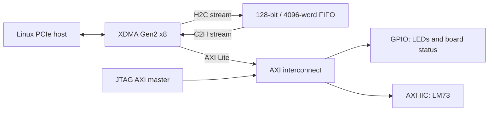

# Build, program, and test the Kintex-7 accelerator

## Verified result and repeat procedure

On November 12, 2026, the baseline `build/accelerator.bit` passed JTAG download,
GPIO/LM73 tests through JTAG and PCIe, and five exact-match DMA loopbacks from
16 B to 4 MiB. Linux reports `10ee:7021` at **5.0 GT/s, x8**. See
[the validation record](RESULTS.md) and `reports/slot_retest_20261112_004428/`.

The successful hardware arrangement is the FPGA in the ASUS M5A97 R2.0's
**upper blue x16 slot**, with the GPU in the lower black slot. The FPGA gets
power only from its PCIe slot. The earlier lower-slot failure did not require
a change to the baseline bitstream or its constraints to achieve this result.

To repeat with the already-built, validated image, an existing Xilinx endpoint,
and the XDMA driver available, run in a desktop terminal:

```bash
cd /home/vsananda/work/pcie-xdma-codex
bash scripts/retest_slot.sh
```

The script verifies the recorded baseline SHA-256, discovers exactly one Xilinx
endpoint, detaches it, programs SRAM, runs JTAG checks, rescans/rebinds the
endpoint, then tests DMA and PCIe registers. Enter the sudo password when
prompted. Require `SLOT_RETEST_PASS`; evidence is archived under a timestamped
`reports/slot_retest_*` directory. It neither writes flash nor restarts Linux.
The hash deliberately pins the tested image; for a fresh build or a host with
no existing endpoint, use the individual steps below.

## Hardware and tools

- YPCB-00338-1P1 with XC7K480T-2FFG1156; board pin map is vendored in
  `vendor/part0_pins.xml`. The linked article uses the spelling YPCB-00388-1P1.
- Board powered with cooling, and a Xilinx Platform Cable USB II attached to JTAG.
- PCIe connection to a Linux host for XDMA. JTAG alone can program the design and
  exercise the GPIO and temperature sensor, but cannot test host PCIe DMA.
- Vivado 2026.1 with Kintex-7 device support and a working license. Tested executable:
  `/opt/2026.1/2026.1/Vivado/bin/vivado`. Vivado reported a valid BASIC license.
- Linux build tools, Git, Python 3.9+, and headers matching `uname -r`.
  Tested kernel: `6.8.0-149-generic` on Ubuntu 24.04.5.
- Administrator access for PCIe rescan and loading the XDMA kernel module.

Run all commands in this repository. If needed, add Vivado to the current shell:

```bash
source /opt/2026.1/2026.1/Vivado/settings64.sh
sudo apt install build-essential git python3 linux-headers-$(uname -r)
```

Do not insert or remove a conventional desktop PCIe card while powered. The JTAG
programming procedure below assumes the card is already installed and powered.

## Design

The article provides a block diagram and configuration screenshots, rather than a
project archive. `scripts/create_design.tcl` reconstructs those components:



The endpoint advertises vendor/device `10ee:7021`, subsystem `10ee:0007`, and
class `058000`, matching the article's ID screenshot. There is one H2C and one
C2H stream channel, each 128 bits wide. FIFO capacity is 64 KiB, with TKEEP and
TLAST preserved. It is a loopback, with no arithmetic accelerator or DDR memory.

The JTAG AXI master, diagnostic status register, and independent clock domain are
additions for bring-up. The AXI interconnect crosses between the XDMA clock and
the board's 50 MHz oscillator. GPIO and IIC remain usable without a trained PCIe
link. Startup reset is held for 255 oscillator cycles. The debug hub also uses this independent clock, verified by
`scripts/check_debug_clock.tcl`. No board reset button is needed. PCIe PERST# still resets the XDMA core normally.

| Address in JTAG AXI / XDMA user BAR | Register |
| --- | --- |
| `0x00000` | GPIO channel 1 data: LED output bits 2:0 |
| `0x00008` | GPIO channel 2 data: read-only diagnostic status |
| `0x10000`–`0x1ffff` | AXI IIC register window |

Status fields: bits 31:24 = `0xc7`; bits 23:6 = advancing clock counter;
bits 5:3 = internal LED output readback; bit 2 = synchronized XDMA reset released;
bit 1 = synchronized PCIe PERST#; bit 0 = synchronized PCIe link up. LED readback
checks the FPGA output logic, not emitted light or the board's LED wiring.

Pin constraints are explicit, so no global Vivado board-file installation is
needed. `constraints/board.xdc` uses the upstream pin definitions, 1.8 V user
I/O, 50 MHz system clock, and 100 MHz PCIe reference clock. GPIO and open-drain
IIC ports have explicit asynchronous timing exceptions. PCIe timing constraints
come from the XDMA IP; AXI clock crossings use the interconnect's generated CDC.

## Probe and build

```bash
./scripts/run.sh probe_hardware
./scripts/run.sh build
```

The probe must identify `xc7k480t_0`. The build creates the block design, validates
connections and address mappings, generates IP and the HDL wrapper, runs
synthesis and implementation, and writes the bitstream. It checks setup and hold
slack before exporting the final artifacts. The shell wrapper requires the
`BUILD_PASS` marker because Vivado can return zero after some Tcl errors.

| Artifact | Purpose |
| --- | --- |
| `build/accelerator.bit` | Bitstream to program |
| `build/accelerator.xsa` | Hardware platform export including bitstream |
| `build/accelerator/accelerator.xpr` | Project for opening in Vivado GUI |
| `reports/accelerator_bd.tcl` | Vivado-exported block design |
| `reports/build.log` | Full build transcript |
| `reports/timing_summary.rpt` | Setup, hold, and timing coverage |
| `reports/utilization.rpt` | Used logic, memory, and transceivers |
| `reports/bus_skew.rpt` | CDC bus-skew constraint checks |
| `reports/drc.rpt` | Design rule checks |
| `reports/methodology.rpt` | Methodology checks |

To inspect the project in the GUI:

```bash
vivado build/accelerator/accelerator.xpr
```

### Check the board-specific PCIe constraints

[TiferKing's board guide](https://www.tiferking.cn/index.php/2024/12/19/650/)
warns that automatic PCIe transceiver constraints can fail. Check the actual
routed design after building:

```bash
./scripts/run.sh check_pcie_constraints
```

Require `PCIE_CONSTRAINTS_PASS`; details are in
`reports/pcie_constraints_audit.rpt`. The script checks all 32 differential
lane pins, GTX lane-to-pad connections, lane 0–7 placement at X0Y23–X0Y16,
the PCIE_X0Y0 hard block, J8/J7 reference-clock pins and their 100 MHz
constraint, and Y26 PERST#. These match the author's manual `pcie_port.xdc`
and board pin map. The current build already passes, so no additional GTX
placement override is necessary. A correct clock constraint does not prove
the slot is physically supplying that clock.

## Simulate the generated stream FIFO

After design generation (or after the build), run:

```bash
./scripts/simulate_fifo.sh
```

This uses the exact generated FIFO wrapper and Vivado simulation libraries. It
sends 12,000 words (192,000 bytes), holds the receiver long enough to fill the
FIFO, then applies deterministic randomized backpressure. It checks every data
word, TKEEP, TLAST, output stability during stalls, and that no extra words
appear. Reset is held beyond the simulator's initial global reset. Results are
in `reports/fifo_simulation.log`; success requires `FIFO_SIM_PASS`. This is a
FIFO simulation, not a simulation of the PCIe host or DMA engines.

## Download and test over JTAG

Use exclusive JTAG and DMA access. If Linux already lists a Xilinx endpoint,
detach it before changing the FPGA image, even if it has a different device
ID. This removes its driver and stale BAR assignments until the later rescan:

```bash
lspci -Dnn -d 10ee:
# Use the FPGA address from that output; this was 0000:01:00.0 on the tested host.
sudo bash scripts/detach_fpga.sh 0000:01:00.0
```

The detach helper validates the vendor and refuses if XDMA device nodes are
open. Stop all FPGA clients first. If no endpoint exists, skip detachment.
Now download and test:

```bash
./scripts/run.sh program
./scripts/run.sh test_jtag
```

Programming targets the single connected XC7K480T at 6 MHz JTAG. It verifies DONE
is high and configuration CRC error is clear. The test checks the design
signature, verifies that the independent clock counter advances, writes eight
LED patterns and reads back the FPGA output logic, and reports PCIe state.

It then probes only the six valid LM73 addresses (`0x48`, `0x49`, `0x4a`, `0x4c`,
`0x4d`, `0x4e`), reads identification register 7 and requires `0x0190`. It reads
three temperatures from register 0, interpreted as signed 16-bit data divided by
128 degrees Celsius. The test uses AXI IIC dynamic start/repeated-start/stop
commands and has bounded polling. Success ends with `JTAG_TEST_PASS`.

This is volatile JTAG programming. Reprogram after a power cycle. No flash erase
or write is part of this procedure.

## Linux driver and PCIe enumeration

Build the driver against the running kernel:

```bash
./scripts/build_driver.sh
```

The script pins AMD's `dma_ip_drivers` repository to commit
`a918c5196a09f95756af244a607d543d9dce5bfb`. It builds `xdma.ko` and the vendor
host tools without installing them system-wide.

After programming, Linux needs a PCIe rescan if the old endpoint was detached
or the FPGA was not an endpoint during boot. The prepared setup script rescans,
checks `10ee:7021`, loads the local XDMA module if no `xdma` module is already
loaded, waits for device nodes, and grants only the invoking user access. Run this
in a desktop terminal (for example, open Terminal with Ctrl+Alt+T), where sudo
can prompt for your password:

```bash
cd /home/vsananda/work/pcie-xdma-codex
set -o pipefail
sudo bash scripts/host_setup.sh 2>&1 | tee reports/host_setup.log
```

If sudo reports “a terminal is required to read the password”, setup has not
run. Retry in the desktop terminal, and enter the password only at its sudo
prompt. A command interface without a terminal cannot handle that prompt.
Without `pipefail`, the pipeline can report exit code 0 from `tee` even when
sudo fails; inspect the log as well as the exit status.

The script does not remove existing PCIe devices or reset host bridges. If the
firmware disabled an empty root port during boot, a rescan may be insufficient;
see troubleshooting below. Expect `/dev/xdma0_user`, `/dev/xdma0_h2c_0`, and
`/dev/xdma0_c2h_0`. `lspci -vv -d 10ee:7021` reports negotiated link speed/width;
they may be lower than the endpoint's Gen2 x8 capability if the slot has fewer
lanes.

On this ASUS M5A97 R2.0, the successful FPGA test used the upper blue slot.
The [ASUS manual, E7438](https://dlcdnets.asus.com/pub/ASUS/mb/SocketAM3+/M5A97_R2.0/E7438_M5A97_R20_Manual_web_hi-res.pdf),
printed pages ix and 1-14, specifies that the blue slot is wired for x16 and
the black slot for x4, although both slots have x16-length connectors. An x8
card leaves part of an x16 connector unused; this is normal. The endpoint
should negotiate a narrower link, so the x4 wiring alone does not explain the
earlier absence of any link in the lower slot. In the upper slot the baseline
negotiated **Gen2 x8**, behind root port `0000:00:02.0`, endpoint `0000:01:00.0`.
The GPU was behind `0000:00:15.0` at `0000:06:00.0/1`. A verified
copy of the manual and its retrieval URL are in
`reports/asus_m5a97_r20_manual.pdf` and
`reports/asus_m5a97_r20_manual_source.txt`.

### Why the two slots behaved differently

The slots connect to different PCIe controllers. The upper blue x16 slot uses
AMD 970's graphics root port (`00:02.0`, PCI ID `1002:5a16`). The lower black
x4 slot uses the SB950 southbridge PCIe port (`00:15.0`, `1002:43a0`). Current
sysfs topology establishes this: the FPGA is below the former, and the GPU is
below the latter. See `final_hardware_state.json` and `pci_tree_after.txt` in
`reports/slot_retest_20261112_004428/`.

An x8 endpoint should normally negotiate down to x4. The design's X8 setting
specifies its maximum width, so four available lanes alone should not prevent
a link. In the upper slot, the unchanged bitstream linked at its full Gen2 x8
capability and passed DMA. This rules out a general failure of the bitstream
or the board-specific PCIe placement; it does not validate x4 negotiation.

In the earlier lower-slot boot, `00:15.0` was absent from Linux's PCIe inventory.
The FPGA had clock locks, completed transceiver resets, and evidence of training
activity, but never linked. A plausible explanation is that firmware hid or
disabled the southbridge port after unsuccessful boot-time training, preventing
later JTAG programming and a Linux rescan from recovering it. Reference AMD
SB900 initialization code has such behavior, but this ASUS BIOS's controlling
registers were not read successfully. Link-width negotiation or electrical
compatibility also remain possible. The lower slot now works with the GPU, so
it is not simply a dead slot. The exact cause was not isolated by the slot move.

Use the upper blue slot for the validated configuration. If a future rescan
finds no endpoint, preserve the JTAG status and PCIe inventory. Moving a card
requires shutdown and disconnected mains power. The earlier warm restart hung,
and the accelerator flash experiment caused a reported blank-screen boot;
[the recovery record](RECOVERY.md) documents the tested recovery. No project
script restarts the host automatically.

## Secure Boot module signing (when required)

The successful test ran with Secure Boot enabled and a working XDMA reference
driver already loaded. Its sysfs version was `2025.2.0`, source version
`E1896DEC0BC5043CC17B09B`, matching the local build; the path and signing process
of the loaded file were not established. No signing, trust, or boot setting was
changed in this retest. Use the following steps only if loading is rejected.

With Secure Boot enforcement, an unsigned local module may be rejected. Check
the current state before attempting to sign or enroll anything:

```bash
mokutil --sb-state
mokutil --test-key /var/lib/shim-signed/mok/MOK.der
```

If that existing certificate is enrolled, sign the compiled module using its
matching private key (the signing command runs as root; do not copy the key):

```bash
sudo /usr/src/linux-headers-$(uname -r)/scripts/sign-file sha256 \
  /var/lib/shim-signed/mok/MOK.priv \
  /var/lib/shim-signed/mok/MOK.der \
  vendor/dma_ip_drivers/XDMA/linux-kernel/xdma/xdma.ko
sudo bash scripts/host_setup.sh
```

If it is not enrolled, an administrator must arrange an approved module-signing
and enrollment workflow. On Ubuntu, enrollment of the existing machine owner
certificate can be requested with `sudo mokutil --import
/var/lib/shim-signed/mok/MOK.der`, followed by a reboot and confirmation in the
firmware's MOK manager. That changes the machine's trust store and requires
physical interaction; it is **not performed by this project's scripts**. The
board may also lose its volatile bitstream during the reboot, requiring JTAG
programming again. Rebuilding the module replaces its signature, so sign again
after any rebuild. The results file distinguishes driver compilation from
actual driver loading and DMA validation.

## Run the DMA loopback

```bash
./scripts/run.sh test_dma
```

The test runs a receiver and transmitter concurrently. This matters for transfers
larger than 64 KiB: writing first and reading afterward can deadlock when the FIFO
fills. It sends deterministic pseudorandom payloads of 16 B, 4 KiB, 64 KiB, 1 MiB,
and 4 MiB. Each result requires an exact byte comparison, and records a SHA-256
hash and elapsed time in `reports/dma_results.json`. A 30-second deadline bounds
each transfer. Success ends with `DMA_TEST_PASS`. Times include Python process
startup and disk I/O and are not PCIe throughput benchmarks.

## Test GPIO and temperature through PCIe

```bash
./scripts/run.sh test_pcie_registers
```

This x86 Linux test maps `/dev/xdma0_user`. It checks PCIe ID `10ee:7021` and
signature `0xC7` before writing, verifies link/reset state and the advancing
counter, then writes and reads back eight LED patterns. It restores the
original LED setting. It uses AXI IIC dynamic transactions to require LM73 ID
`0x0190` at the board's observed address `0x4A`, then reads three temperatures.
Run it without concurrent JTAG or other register clients. Success requires
`PCIE_REGISTERS_PASS`; results are in `reports/pcie_register_results.json` and
`reports/test_pcie_registers.log`. This exercises the XDMA AXI-Lite path as well
as the stream path covered by the DMA test.

## Persistent boot from BPI flash

On the tested ASUS M5A97 R2.0 host, the prepared accelerator flash image
caused a user-reported blank-screen boot failure. Holding SW1 during power-on
allowed Linux to start, and the original flash was restored and
verified against the complete backup on November 11. **Do not repeat this accelerator flash
write on this host until the startup failure is diagnosed.** Use
[the recovery record](RECOVERY.md) for the tested recovery procedure and
`docs/RESULTS.md` for the current state. The commands below document the flow
that was performed. The later successful Gen2 x8/DMA test used a new SRAM
download in the upper slot, with no flash writes. Current flash contents were
not reread in that test; persistent accelerator boot remains unvalidated.

This is a separate procedure because it replaces existing flash contents. It is
useful when firmware disables the PCIe slot before a JTAG download can occur.
The board definition and upstream hardware guide identify a Micron
MT28GU512AAA1EGC, 512 Mbit / 64 MiB, with a 16-bit parallel interface. Vivado's
matching part is `mt28gu512aax1e-bpi-x16`. The cold-boot JTAG probe on this board
read mode pins `010` (Master BPI). The programmer returned manufacturer `89`
and device type `887e`.

First back up the entire device. Do not run another JTAG command concurrently:

```bash
./scripts/run.sh backup_flash
```

The script loads Vivado's flash-access helper into FPGA SRAM, reads all 64 MiB
into a timestamped file under `backups/`, rereads the first 4096 bytes and
compares them, then restores `build/accelerator.bit`. It does not erase or
program flash. Require both `FLASH_BACKUP_PASS` and `SRAM_RESTORE_PASS`.
The full read takes several minutes at 6 MHz JTAG. Preserve this backup: the
device contains data, even though its current contents did not configure the
FPGA successfully on the observed cold start.

Prepare and validate the new boot image:

```bash
./scripts/run.sh prepare_flash
python3 scripts/record_flash_artifacts.py
./scripts/run.sh program build/accelerator_boot.bit
./scripts/run.sh test_jtag
./scripts/run.sh program_flash --check
```

`prepare_flash` opens the already routed checkpoint and emits a separate,
compressed bitstream with Master BPI x16, asynchronous flash reads, a 3 MHz
configuration clock, and CCLK startup. It does not resynthesize or reroute the
logic. The conservative clock setting is for initial flash-boot validation;
PCIe discovery at power-on still needs to be measured on the host.
`accelerator_boot.mcs` covers byte addresses `0x00000000` through `0x003C753F`
in the current build (3,962,176 bytes). `accelerator_boot.prm` records the range
for each newly generated image.

The artifact checker verifies the complete backup, the repeated header read,
every Intel HEX record checksum, contiguous addresses, and exact correspondence
between the MCS data and the bitstream using BPI x16 bit and byte ordering. It
records hashes in `reports/flash_artifacts.sha256` and details in
`reports/flash_artifacts.json`. The `--check` step validates those hashes and
Vivado memory properties without any flash operation.

After reviewing the image and agreeing to replace its occupied flash sectors,
write it explicitly:

```bash
./scripts/run.sh program_flash --write
./scripts/run.sh test_jtag
```

The write command checks the recorded hashes, erases the sectors required by
the image, blank-checks, programs, and verifies them. It then asks the FPGA to
reload from flash without restarting the PC, checking DONE, CRC status, and
the presence of the JTAG AXI master. Require `FLASH_PROGRAM_PASS`,
`FLASH_BOOT_PASS`, and the subsequent `JTAG_TEST_PASS`. A successful JTAG
download of the boot bitstream alone does not prove that flash boot works.
The prepared 3,962,176-byte image occupies 16 of the flash's 256 KiB erase
blocks: `0x00000000`–`0x003FFFFF` (4 MiB). Erasing those blocks also removes
old bytes after the image's end within the last block; the full original
contents remain in the backup.

Finally, after saving host work, a coordinated power-off/power-on tests whether
the FPGA configures early enough for firmware to enumerate PCIe. After login,
check `lspci -Dnn -d 10ee:7021` and run the JTAG test **before** any new SRAM
download. Continue with driver setup and DMA testing below. A flash-programming
pass is not a PCIe/DMA test pass. See `docs/RESULTS.md` for the recorded flash
write, boot test, and current PCIe/DMA completion status.

If flash boot fails, JTAG can restore the working SRAM image with
`./scripts/run.sh program`; preserve the backup and programming logs before
changing the boot image again. Do not erase the whole flash as a diagnostic.

## Troubleshooting

For deeper clock/reset and link-training observations, see
[the JTAG PCIe diagnostic build](PCIE_DIAGNOSTICS.md). It retains the Gen2 x8
endpoint and FIFO while adding status pages accessible without a PCIe link.

The earlier lower-slot diagnostic capture on this host showed PLL lock, completed
transceiver reset, released hard-block reset, and sticky training activity,
but no link. To collect the host's firmware slot descriptions, PCIe details,
ACPI tables, and kernel log without changing settings, run:

```bash
sudo python3 scripts/collect_host_pcie.py
```

The collector writes a timestamped `reports/host_pcie_*` directory and prints
`HOST_PCIE_CAPTURE_PASS` when collection finishes. Check individual command
exit codes in its `capture.json`; this marker is not a PCIe test pass. Treat
firmware slot descriptions as clues, since some BIOSes leave them incomplete.

- **No JTAG target:** check `lsusb` for `03fd:0008`, power, cable orientation and
  cable-driver permissions. The probe log includes the selected cable and device.
- **No AXI master after programming:** confirm the bitstream is this project's
  build, DONE is high, and the 50 MHz board clock is running.
- **LM73 not found:** inspect the test log, board model, and IIC pin mapping.
  An ID mismatch is a failure even if the returned temperature looks plausible.
- **PCIe link down:** inspect the three PCIe status bits from the JTAG test. If
  PERST# is low, the host is holding the endpoint in reset; a missing reference
  clock or disconnected slot can also prevent link training.
- **No endpoint after rescan:** check the slot connection and firmware settings.
  The tested solution on this host was moving the FPGA to the upper blue x16
  slot with power disconnected, then downloading the existing SRAM bitstream
  and rescanning. Some machines disable unoccupied ports at boot. Preserve the
  PCIe and JTAG results before further changes; the historical warm restart and
  accelerator flash boot both failed on this host.
- **Driver loading fails with “Key was rejected by service”:** Secure Boot
  requires a module signed with an enrolled key. Sign with the machine's existing
  trusted module-signing key, then rerun setup; see the measured results for this
  host's configuration. Do not assume successful compilation means loading passed.
- **Driver nodes absent:** inspect `sudo dmesg`, the PCIe ID, driver binding, and
  the kernel version used to build the module.
- **DMA timeout or mismatch:** preserve logs, check link state and driver errors.
  Reprogramming resets stream state; detach the FPGA with `detach_fpga.sh`
  before reprogramming, then rerun host setup. Do not run two loopback clients
  on channel 0 together.

## References

- [ControlPaths article](https://www.controlpaths.com/2025/05/18/kintex7-accelerator/)
- [Board reverse-engineering files](https://github.com/TiferKing/ypcb_00338_1p1_hack)
  at `8b13ecf71b7061dd43a2b1580f0caa469f64303f`.
- [AMD XDMA drivers](https://github.com/Xilinx/dma_ip_drivers)
- [TI LM73 data sheet](https://www.ti.com/lit/ds/symlink/lm73.pdf)
